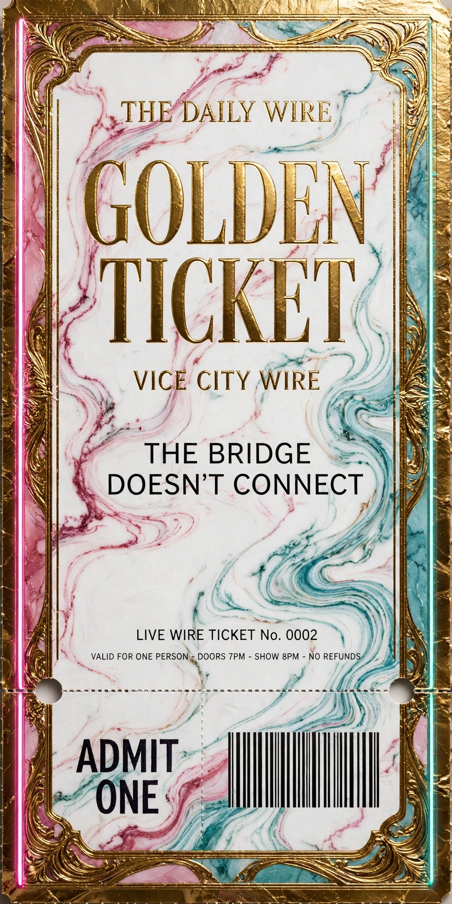
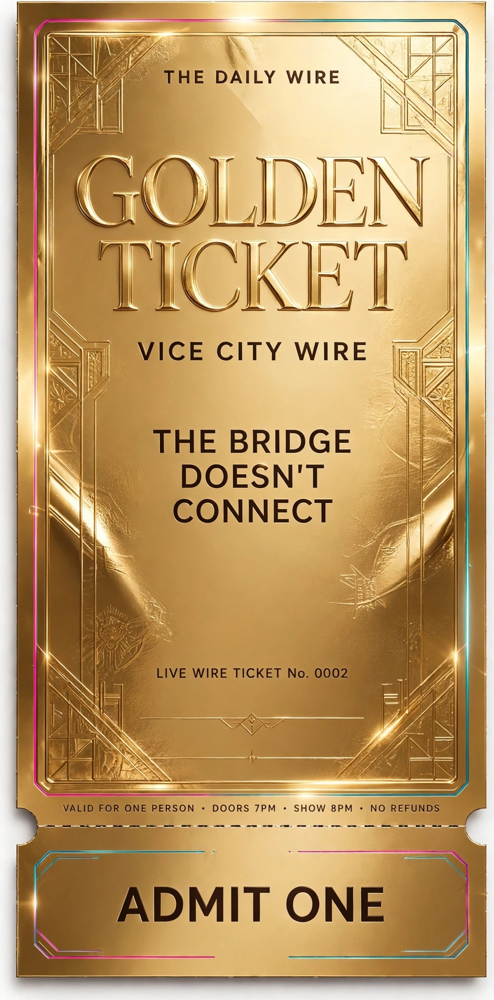

# 🎟️ LIVE WIRE TICKET™

**The ticket is the show.**

The Live Wire Ticket™ is a video format created by **Vice City Wire**. A piece of content doesn't open with a title card — it opens with a *ticket*. The ticket states what the piece is, the way a newspaper headline does. Then it live-wires — like amperage — straight into the video. A matching ticket back closes the piece.

Nobody else is handing these out.

## The play

1. **THE FACE** — a real-looking foil ticket, built like an actual ticket: perforation, notched ADMIT ONE stub, barcode. The face states what the piece is. It moves — a slow push-in, about two seconds, under a hype sound.
2. **THE WIRE-IN** — a white-flash cut, straight into the content. No menu, no intro card. The ticket *becomes* the show.
3. **THE BACK** — the ticket's back closes it: the wire carried it live, the ticket number, and the instruction on every ticket ever printed: **PASS THIS TICKET ON.**

## The schemes

- **FULL GOLD** — crinkled gold foil, pink on the left edge, teal on the right.
- **MARBLE WHITE** — white ticket, gold foil, pink and teal marble veining through the interior.

Pink and teal are the proper colors. The foil is gold. That's the canon.

## The Token

Where a ticket can't fit — round marks, avatars, small surfaces — the mark rides as a **Token**: a gold coin carrying the same name. Ticket where it fits, Token where it doesn't.

## Tickets are numbered

Every issued ticket carries a number. First issued:

- **Ticket No. 0002 — THE BRIDGE DOESN'T CONNECT** — first issued November 21, 2026, by Vice City Wire ([@vicecitywire92](https://www.instagram.com/vicecitywire92/)), and handed to working creators and artists the same night.

## Use = permission

This format is published here so anyone can see it, study it, and know whose it is.

**Using it requires written permission first.** See [LICENSE](LICENSE). If you want to run tickets for your own content, ask — licensing is the whole idea:

- Instagram: [@vicecitywire92](https://www.instagram.com/vicecitywire92/)
- Ask for the Live Wire Ticket™ license.

## The fine print on every ticket

> VALID FOR ONE PERSON · DOORS 7PM · SHOW 8PM · NO REFUNDS

---

*LIVE WIRE TICKET™ is a trademark of Bumkus IP / Vice City Wire, claimed November 21, 2026. Format specification: [FORMAT.md](FORMAT.md).*
